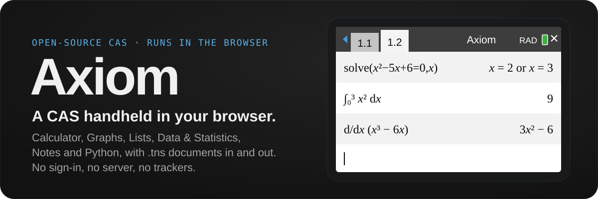
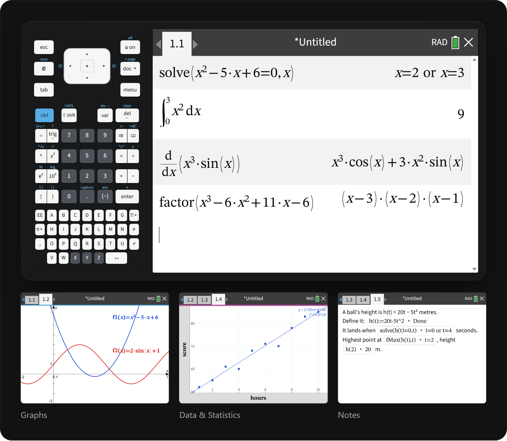
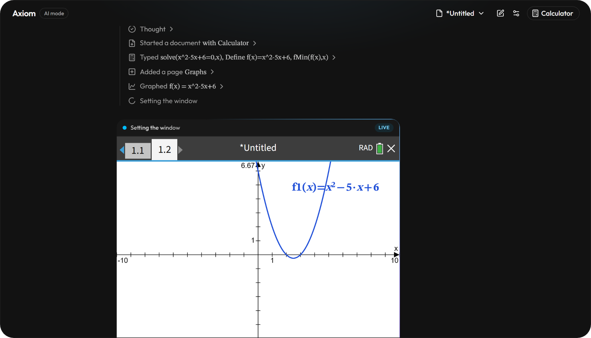
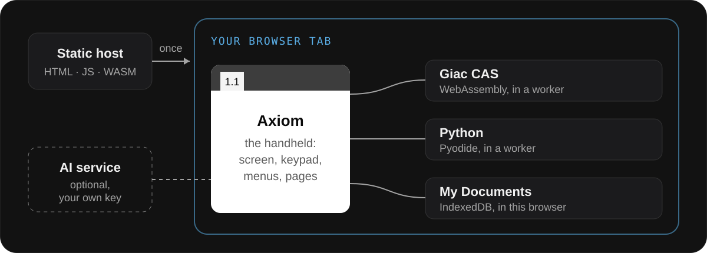

<h1 align="center">
  
</h1>

**Axiom is a computer algebra system (CAS) calculator that runs entirely in your browser, laid out like the TI-Nspire™ CX II CAS** students already know: the same Home screen, documents of pages, menus and keys. It opens and saves `.tns` documents, needs no account, and sends nothing anywhere unless you turn on the optional AI assistant.

Axiom is built on [VCE Hub's open-source CAS](https://github.com/vcehub/cas), the calculator it grew from, and does its maths with [Giac](https://www-fourier.univ-grenoble-alpes.fr/~parisse/giac.html). Licensed [GPL-3.0-or-later](LICENSE).

**Status:** early, in active development. Most of the handheld works today; `.tns` export is experimental. See [Limits](#limits) before relying on it.

<p align="center">
  
</p>

## Why Axiom

- **Nothing to install or buy.** It's a static website that runs in any modern browser.
- **The layout your class uses.** Pages, menus and keys sit where they do on the handheld, and commands are typed the way you'd type them there. Of 188 commands typed as a student would, all 188 give the handheld's answer ([benchmark](docs/cas-benchmark.md)).
- **Works offline.** After the first visit, the whole calculator (the CAS and Python included) is kept in your browser, so it runs with no connection. It can be installed as an app, and in Chrome or Edge the installed app opens `.tns` files from your computer.
- **Your files.** `.tns` documents open here (Calculator history, Lists, Notes, Python, variables) and save back out. They're kept in your browser, not on a server.
- **No sign-in, no trackers, no analytics.** VCE Hub's hosted calculator asks you to sign in; Axiom runs its open-source base without an account.

**Use something else when:** you're in an exam (Axiom isn't an approved device; use your handheld), you need Lua programs (not built), or you need a guarantee that a `.tns` file opens in TI's own software (export is unverified).

## Quick start

You need [Node.js](https://nodejs.org) 22.12 or newer, and an internet connection the first time.

```bash
git clone https://github.com/notnooob/axiom.git
cd axiom
npm install
npm run dev
```

Open <http://localhost:5173>. The first `npm run dev` downloads Giac's WebAssembly build (19 MB, checked against the SHA-256 in [`public/cas/giac/SOURCE.md`](public/cas/giac/SOURCE.md)) and copies Pyodide into `public/`. After that, nothing is fetched from outside.

To publish it, run `npm run build` and serve the `dist/` folder from any static host; paths are relative, so a subfolder works. Python's live keys and `input()` need cross-origin isolation: [`public/_headers`](public/_headers) sets it on Cloudflare, and the service worker ([`public/sw.js`](public/sw.js)) sets it on hosts that can't send headers, such as GitHub Pages; the same worker keeps every file for offline use. The live site is built and served by Cloudflare Workers from `main`.

## What's in it

| Part | What it does |
|---|---|
| **Home and files** | Scratchpad, Documents (New, Browse, Recent, Current), My Documents with folders, upload by drag and drop (a zipped calculator folder keeps its structure), download, export everything as a zip. |
| **Calculator** | Exact and decimal answers, `solve`, calculus, matrices, probability distributions, statistics, finance, `Define`. 202 of the handheld's 346 Calculator menu items are built; the rest show greyed. |
| **Graphs** | Functions, relations, parametric curves, differential equations, sliders, trace and analyze, scatter plots of lists. |
| **Geometry** | Points, lines, segments, rays, circles, triangles and polygons; midpoints, intersections, perpendiculars, parallels and bisectors; reflections, rotations, translations, dilations and point symmetry; live length, area, angle and slope measurements that follow when you drag a point, and can be stored as variables for the Calculator. Pan, zoom, snap to grid, undo. |
| **Lists & Spreadsheet** | Named columns become lists for the whole problem; cell formulas like `=a1+b1`, column formulas like `=seq(n^2,n,1,10)`. |
| **Data & Statistics** | Dot, box, histogram, normal probability, scatter and XY-line plots; linear, quadratic, power, exponential and logarithmic regressions with r²; movable line. |
| **Notes** | Text with maths boxes that work out (and define variables), chem boxes, comments, templates, formatting, and every Calculator command. |
| **Python** | Editor and shell on Pyodide, with `ti_system`, `ti_draw` and `ti_plotlib`, live keys, `input()` and Esc to stop. |
| **Keys** | Ctrl+M menu, Ctrl+K document, Ctrl+I add a page, Ctrl+S save, Ctrl+H home, Esc to step back. On the on-screen keypad, ctrl then a letter does the same. |

## The assistant

<p align="center">
  
</p>

An optional AI that works the calculator for you. Paste a question, or a screenshot of one, and it makes the document, types the entries, plots the graphs and explains the working briefly, with maths typeset. In **AI mode** the chat takes the page and the calculator's real screen sits under the reply, live while the agent works; the finished document can be saved, downloaded as `.tns`, or opened in the calculator.

Bring your own key for Anthropic, OpenAI, Google, OpenRouter or any OpenAI-compatible endpoint (a local server works). The key is stored in this browser and sent only to that service, with the calculator's state for each message. It's off until you add one.

If a reply did something you didn't want, **Undo changes** puts the calculator back as it was before that reply (files it saved stay in My Documents).

Four **modes**, chosen in the composer, set how much it does for you. **Solve** does the question on the calculator. **Exam** does it the way you would in a CAS-active exam: the menu keys for each command and the lines to write on paper. **Guide** coaches one step at a time while you press the keys and write the working. **Check** marks your working, on the calculator or in a photo. In every mode it can put numbered **highlights** on your own work on the calculator (a history line, a cell, a point or curve, a Geometry object) to show where it went wrong. Models that can't read images get the screen described in words; Axiom notices when a model refuses a picture, and you can set it in Settings.

The same 26 tools (Geometry, Notes, Analyze Graph, highlights and a look at the screen included) are offered to agents in the browser through [WebMCP](https://webmachinelearning.github.io/webmcp/) (`document.modelContext`), where the browser supports it.

## How it works

<p align="center">
  
</p>

Everything runs in the browser tab. The page (React and TypeScript) sends each entry to Giac, compiled to WebAssembly, in a worker, and Python to Pyodide in another. Documents live in IndexedDB. `.tns` files are read and written in the page: the ZIP container, TI's encryption and its compressed XML, ported from [TnsTools](https://github.com/MaksimirKurtov/TnsTools).

## Limits

- **`.tns` export is experimental.** Files read back here, but only TI's software or a handheld can confirm they open there. Graphs and Geometry pages made in Axiom aren't written to `.tns` yet.
- Lua programs (most handheld games) don't run, and Geometry pages in a `.tns` file don't open yet; both keep their tab and data.
- Ndless programs can be stored and downloaded, never run (they're ARM code for the handheld).
- Multi-line TI-Basic programs in a document's variables aren't brought across.
- Some `.tns` files use a compression case the decoder doesn't know yet; opening one shows the error.
- 144 Calculator menu items aren't built yet, including TI-Basic programming and several hypothesis tests. The [benchmark](docs/cas-benchmark.md) lists them.

## Development

```bash
npm test          # unit tests
npm run bench     # every Calculator command through the real engine → docs/cas-benchmark.md
npm run build     # typecheck and build to dist/
node scripts/ai-eval.mjs   # the assistant on a real model, with your key (see the file; spends tokens)
```

[AGENTS.md](AGENTS.md) maps the code for contributors and coding agents.

The `.tns` tests can also run against your own documents, which can't be committed: `AXIOM_TNS_CORPUS=path/to/Documents.zip npm test`.

| Path | What's there |
|---|---|
| `features/cas/` | The handheld: screen, keypad, menus, and each app (`calculator`, `graphs`, `lists`, `data`, `notes`, `geometry`, `python`). |
| `features/cas/tns/` | `.tns` container, encryption, XML, import and export. |
| `features/cas/ai/` | The assistant: tools (shared with WebMCP), services, system prompt, chat and AI mode. |
| `components/ui/` | shadcn/ui components used by the assistant. |
| `public/cas/` | The Giac worker and its source notes. |

## Credits

Axiom is an independent project derived from [**VCE Hub's open-source CAS**](https://github.com/vcehub/cas) (Copyright © 2026 VCE Hub, GPL-3.0-or-later); it is not affiliated with VCE Hub. The calculator, its engine wiring, menus, Graphs and the screen design come from that project; Axiom adds the Home screen and files, `.tns` support, Lists & Spreadsheet, Data & Statistics, Notes, Python and the assistant.

It also stands on [Giac](https://www-fourier.univ-grenoble-alpes.fr/~parisse/giac.html) by Bernard Parisse and Renée De Graeve, [Pyodide](https://pyodide.org), [TnsTools](https://github.com/MaksimirKurtov/TnsTools), [amicro](https://github.com/Subhan-code/Amicro--Micro-transitions-), [shadcn/ui](https://ui.shadcn.com), the [AI SDK](https://ai-sdk.dev), [KaTeX](https://katex.org) and the STIX Two, Source Sans 3 and Outfit fonts. Licences and details are in [NOTICE.md](NOTICE.md).

## License

GNU General Public License, version 3 or later: see [LICENSE](LICENSE). Giac's build is GPL too; its corresponding source is linked from [`public/cas/giac/SOURCE.md`](public/cas/giac/SOURCE.md).

TI-Nspire is a trademark of Texas Instruments. Axiom is not affiliated with or endorsed by Texas Instruments, or by the VCAA (VCE is its registered trademark).
